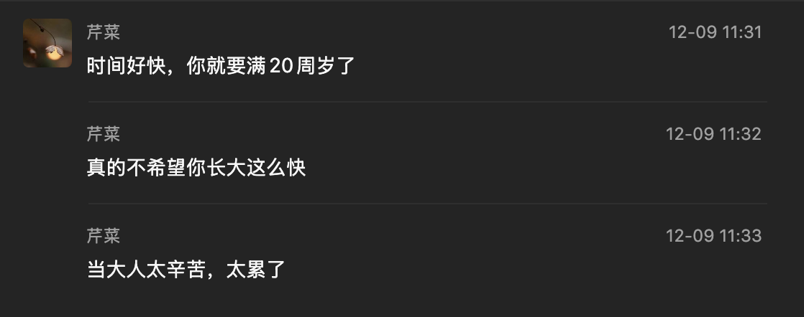

人在极年轻的时候，眼睛总是亮得发烫，看什么都觉得唾手可得。

那时觉得钱是个大得没边的事物，买个东西，手伸进口袋里摸了摸，觉得够了，也就由着性子去了。现在日子往深里走了两步，才渐渐看清了钱的底色。它没什么神气，也不带什么光环，无非就是一个供人驱使的物件。现在再看一双鞋，心里算的是它能陪我走多远的路，能给我省下几分力气，以及我要在发亮的屏幕前头熬上多久，才能把这点光阴填补回来。

刚碰交易那阵子，人像是得了一场醒不过来的热病。总觉得财富这东西唾手可得，仿佛天生就该被我攥在手里。在那些不切实际的幻象里，什么五年十个亿，竟也被当成了顺理成章的坦途。现在回过头去看，那真是一种不知天高地厚的狂妄。前几天我翻了翻账本，26年这户头上的数字，跌跌撞撞地，居然已经是24年刚起步时的十倍了。或许听着风光，可从泥里滚过来的人心里门儿清：这十倍里头，大半是死里逃生捡回来的命。把这点微末的本钱扔进深不见底的市场汪洋里，连个响声都听不见。所以，看着多出来的这十倍，我今天反倒更敢认了：在市场面前，我什么都不懂。

人一旦把那点虚荣剥干净，承认了自己不懂，心里反倒生出一种踏实来。在这个行业里，爆仓的滋味我尝过，连皮带肉地扯下来。跟那比起来，低头认个错、把亏损砍断，又算得了什么呢。如今再看着屏幕上那些红红绿绿的数字跳上去又掉下来，我心里渐渐没了波澜。因为我明白了，那些数字永远跳不到头，而在K线之外，人总归还得好好活着。

今年的春节，我留在了新加坡。隔着屏幕看国内的亲戚朋友聚在一起喝酒吃饭，我在这头的赤道边上，日子静得让人发慌。人就是这样，安稳日子过久了，总觉得生活就这么定下来了。可只要风稍微吹偏一点，那点可怜的规矩就全散了。所以我开始写日记，把自己从肉身里拽出来，像看大街上的路人一样，审视当下的自己。再过七八个月，我就满二十一岁了。每到年底总觉得日子就这么顺水推舟地过了，可真要回头看看这几年的光景，酸甜苦辣一路咽下来，也确实是轻舟已过万重山。

山是翻过去了，可人在这世上拼了命地折腾，图的到底是个什么？现在夜里风吹过来，我走在街上，旁边跟着轩轩。我突然觉得，图的不过是身边能有个人，能跟你踏踏实实地走一段夜路。在这人生地不熟的地方，她不是什么躲在我背后的女孩，她是跟我一块儿扛事、一块儿在风里咬牙的人。我们俩就这么走着，有一搭没一搭地说着闲话，心里的那些窟窿，不知不觉就给填补上了，路也渐渐走宽了。

今年过年没回去，深夜里看着外头的月亮，心里其实算了笔账。爸妈都还年轻，身子骨也硬朗，人总觉得来日方长。可一旦离了故土，这陪伴的账就不能按年算了，得按次算。一年回不去几次，这辈子满打满算还能跟他们见面的日子，伸出两只手可能就数得过来了。红着眼眶熬夜，在市场上抢钱，写代码，做营生，说到底，无非是想从时间手里把往后的光阴赎回来，完完整整地奉还给他们，陪他们四处去走走看看。

要是真有那么一天，这笔账算清了，人不再被生存这根鞭子抽打着往前赶，日子大概就会露出它最原本的底色。真到了不用再拿命去换钱的时候，生活其实就是图一个“不怕”了。早晨睁开眼，看看身边的人，心里不慌；看看外头的天光，不必急着去盘面上拼杀。哪怕只是去做点看似毫无用处的闲事，去出一身痛痛快快的汗，打打球，弹弹琴，也会觉得这光阴是结结实实属于自己的。人终究不是活在什么宏大的终局里，而是活在这些松了绑的、平淡却安稳的片刻里。

有了这些片刻，眼下的苦，也就不算苦了。

又是一年了，新年快乐，所有我惦记的亲人和朋友。

愿我们都能在这个世间，守住自己心里的那点亮光。
